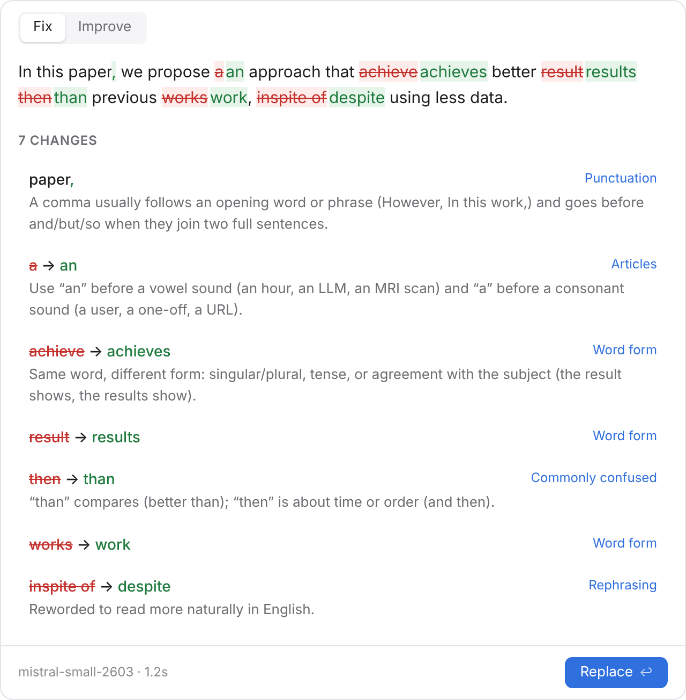

# Penwise

Select text in any app on your Mac, press **⌃⌥P**, and see what's wrong with your English, with a short
explanation of each change. Keep the changes you agree with, press **Return**, and your text is replaced.

Penwise is made for research and professional writing by non-native speakers. It aims to teach as well as correct:
every change comes with a short note, and the fixes you make again and again show up in `penwise insights`.

It works with a cloud model you have an API key for, or a small local model (such as a 1B model on an M1 Mac).
Setup is one command that asks a few questions and does the rest.

<picture>
  <source media="(prefers-color-scheme: dark)" srcset="docs/panel-dark.png">
  
</picture>

## How it works

```
 Any Mac app (text selected)
        │  ⌃⌥P fix  ·  ⌃⌥⇧P improve  ·  ⌃⌥⌘P quick fix
        ▼
 Hammerspoon Spoon (Lua)          reads the selection, shows the review panel, pastes the result
        │  text as an argument → JSON lines
        ▼
 penwise (Python)
   engine.py    split into paragraphs → ask the model (in parallel) → clean → sanity-check → diff
   prompts.py   short prompts with examples, tuned on 1B models
   llm.py       one client for every model: the OpenAI-compatible chat API
   diff.py      word-level diff, computed in code, not by the model
   lessons.py   a label and a fixed teaching note for each change
   history.py   a local log of accepted fixes → "you've made this fix 3× before"
   wizard.py    `penwise setup`: model, key (Keychain), hotkey, all in one go
        │  HTTP
        ▼
 Ollama / LM Studio / llama.cpp / MLX on your Mac   — or —   OpenAI / OpenRouter / Groq / …
```

Three design rules keep it trustworthy:

- **The model only rewrites; Penwise works out the changes.** The list of changes is computed by diffing your text
  against the model's version, so what you see is exactly what will change. You can undo any single change.
- **If the model replies to your text instead of editing it, Penwise doesn't use that reply.** Small models sometimes
  answer a question in your text, or rewrite it completely. Penwise checks each reply and, if it doesn't look like an
  edit of your text, leaves that part unchanged and tells you.
- **Explanations are written in advance, not generated.** Each change gets a label (Articles, Prepositions, Word
  form, Commonly confused, …) and a fixed note. You can also ask the model for a one-line reason per change, but this
  is off by default because 1B models often give wrong ones.

## Quick start (macOS)

1. **Install Penwise** with [uv](https://docs.astral.sh/uv/) (`brew install uv`):

   ```sh
   uv tool install git+https://github.com/LuckyLetter/penwise
   uv tool update-shell    # then open a new Terminal window
   ```

2. **Run the guided setup:**

   ```sh
   penwise setup
   ```

   It asks where the model should run, saves your API key in the macOS Keychain, lets you pick a model from a
   short list, tests it, and installs the hotkey (it can install [Hammerspoon](https://www.hammerspoon.org) for you
   with Homebrew). Press Return to take the suggested answer at every step.

3. **Use it.** Select text in any app and press:

   | Hotkey | What it does |
   | ------ | ------------ |
   | **⌃⌥P**  (Control+Option+P)       | review the fixes, each with a short note, then press Return to replace |
   | **⌃⌥⇧P** (Control+Option+Shift+P) | the same, and also improve clarity and flow |
   | **⌃⌥⌘P** (Control+Option+Command+P) | quick fix: replace right away, with a one-line summary |

| In the review panel |                                   |
| ------------------- | --------------------------------- |
| click / 1–9         | undo or redo a single change      |
| Return              | replace your selection            |
| ⌘C                  | copy the result instead           |
| Tab                 | switch between Fix and Improve    |
| Esc                 | close without changing anything   |

The panel shows a timer while it works, and closes by itself when your text needs no changes. To change the
hotkeys, edit the Penwise block in `~/.hammerspoon/init.lua`; running `penwise setup` again keeps your changes.

## Choosing a model

See the model in use and some suggestions, or switch (Penwise tests the new model before saving it):

```sh
penwise model
penwise model mistralai/mistral-small-2603
```

Every model is reached the same way, through an OpenAI-compatible chat API, so any of these work. `penwise setup`
fills in the right `base_url` for OpenRouter and Ollama.

| Where                 | `base_url`                      | `model` (example)                         |
| --------------------- | ------------------------------- | ----------------------------------------- |
| Ollama (default)      | `http://localhost:11434/v1`     | `gemma3:1b`, `llama3.2:1b`                |
| LM Studio             | `http://localhost:1234/v1`      | the model id shown in LM Studio           |
| MLX (`mlx_lm.server`) | `http://localhost:8080/v1`      | `mlx-community/Llama-3.2-1B-Instruct-4bit` |
| OpenRouter (one key, many cloud models) | `https://openrouter.ai/api/v1` | an id from openrouter.ai/models, e.g. `mistralai/mistral-small-2603` |
| Another cloud service | the service's OpenAI-compatible URL, e.g. `https://api.openai.com/v1` | a model from that service |

**About 1B models:** they catch common errors well (verb agreement, articles, prepositions, spelling, *then/than*).
They miss some errors and now and then over-edit, which is why every change can be undone. The prompts were tuned
on `gemma3:1b` and `llama3.2:1b`; `gemma3:1b` caught slightly more errors. A larger local model or a cloud model
gives better corrections, and its one-line explanations are worth turning on (`explain = true`).

**Speed:** many cloud models "think" before answering, which adds seconds to every check. For the models it
suggests, Penwise turns that down automatically (`reasoning_effort`). For a hotkey tool, a fast model that doesn't
think by default, like `mistralai/mistral-small-2603`, feels best.

**API keys:** `penwise setup` stores the key in the macOS Keychain and points the config at it with
`api_key_command = "security find-generic-password -s penwise -w"`. `api_key_env = "SOME_VAR"` and
`api_key = "..."` also work. Local servers need no key.

## Configuration

`penwise config` shows your settings, and `penwise config set <name> <value>` changes one (for example
`penwise config set explain true`). The file is `~/.config/penwise/config.toml`; `penwise init` writes a version
with every setting explained. All settings:

| Setting           | Default                     | Meaning                                                        |
| ----------------- | --------------------------- | -------------------------------------------------------------- |
| `base_url`        | `http://localhost:11434/v1` | OpenAI-compatible API to use                                   |
| `model`           | `gemma3:1b`                 | model name at that API                                         |
| `api_key_command` | –                           | shell command that prints the API key (e.g. from the Keychain) |
| `api_key_env`     | –                           | environment variable holding the API key                       |
| `api_key`         | –                           | the API key itself (least safe)                                |
| `mode`            | `fix`                       | `fix`: only errors · `improve`: also clarity and flow          |
| `explain`         | `false`                     | also ask the model for a one-line reason per change            |
| `history`         | `true`                      | keep a local log of accepted changes for `penwise insights`    |
| `temperature`     | `0.2`                       | lower is more predictable                                      |
| `timeout`         | `60`                        | seconds to wait for the model                                  |
| `reasoning_effort`| –                           | how long a cloud model "thinks" first (`none`, `low`, …); lower is faster |

## Learning from your changes

```console
$ penwise insights
42 accepted changes since 2026-10-12

What you fix most:
    14  Articles
     9  Prepositions
     7  Word form

Fixes you've made more than once:
     5× in → on
         e.g. …results [in] the other hand…
```

The review panel also tells you when you've made the same fix before. History is a plain JSON Lines file at
`~/.local/share/penwise/history.jsonl`; `penwise history --clear` deletes it, and `history = false` turns it off.

## Privacy

- Your text is sent **only** to the `base_url` you configure. With a local model, nothing leaves your Mac.
- Penwise stores your config, your API key in the Keychain, and (unless turned off) the accepted changes: the
  changed words and up to a few words on each side, never whole texts.
- No telemetry, no accounts, no network calls besides the model API.
- Hammerspoon needs Accessibility permission to copy your selection and paste the result. Penwise puts your
  clipboard back afterwards.

## In the terminal

The panel is optional; `penwise check` works anywhere, including Linux:

```sh
penwise check "We evaluate our approach on three benchmark."   # changes with notes
pbpaste | penwise check -f text | pbcopy                         # just the corrected text
penwise check -m improve -f json < draft.txt                     # everything, as JSON
```

**No Hammerspoon?** In Automator, create a *Quick Action* that receives text in any application, add *Run Shell
Script* with `~/.local/bin/penwise check -f text`, tick *Output replaces selected text*, and give it a shortcut in
System Settings → Keyboard → Keyboard Shortcuts → Services. You get the corrected text, without the review panel.

## Limitations

- Each paragraph is checked separately, so the model doesn't see the rest of your document.
- LaTeX, Markdown and citations are usually kept as they are, but small models occasionally touch them. Check the
  changes on technical text.
- A few apps don't allow reading or pasting text this way. Use ⌘C in the panel and paste yourself.
- If something isn't working, `penwise doctor` checks each part and says what to do.

## Development

```sh
git clone https://github.com/LuckyLetter/penwise && cd penwise
python -m venv .venv && source .venv/bin/activate
pip install -e ".[dev]"
python -m playwright install chromium   # optional: enables the panel tests
ruff check . && ruff format --check . && pytest
```

The tests start a fake OpenAI-compatible server, so no model is needed. `tests/test_spoon.py` runs the Hammerspoon
Spoon in an embedded Lua interpreter with stubbed `hs` APIs, and `tests/test_panel.py` drives the review panel in a
headless browser.

## License

[Apache 2.0](LICENSE)
