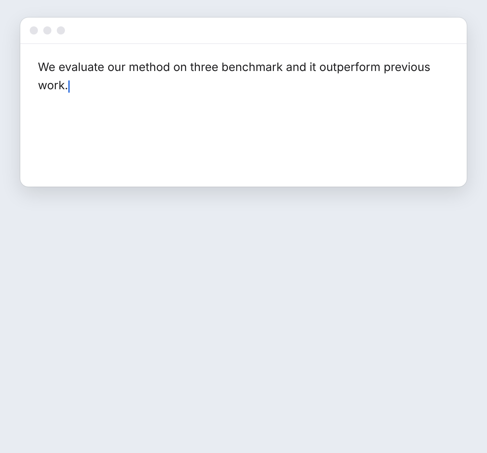

# Penwise

[English 及其他语言](../../README.md) · **中文**

在 Mac 上的任何输入框里写出更好的英文：按 **⌃⌥P**，看一下修改，按 **Return**。

- **随处修正英文**：邮件、聊天、文档、浏览器都可以，不用复制粘贴。
- **边改边学**：每处修改都附有一句规则说明。
- **不会说的先写中文**：用中文写，或写 `[[?]]`，Penwise 帮你写成英文。
- **安全**：不会擅自改动数字、引用、代码和链接，每处修改都可以撤销。

## 安装

1. 下载 **[Penwise.dmg](https://github.com/LuckyLetter/penwise/releases/latest/download/Penwise.dmg)**，打开后把
   Penwise 拖到“应用程序”，再从那里打开。
   - 如果 macOS 提示无法验证这个 App：点 **完成**，打开 **系统设置 → 隐私与安全性**，点 **仍要打开**。
2. 在打开的窗口里填写 AI 服务商提供的 **API 端点**、**API 密钥** 和 **模型**，然后点 **保存**。
   - **不知道选哪个？推荐 [OpenRouter](https://openrouter.ai) 的 `openai/gpt-oss-20b`**：速度快，几乎免费
     （1 美元可以检查一万多次）。在 [openrouter.ai](https://openrouter.ai/settings/keys) 创建密钥并充一点值，拷贝密钥后点一下 API 密钥输入框：
     密钥和 API 端点会自动填好。再在模型里填 `openai/gpt-oss-20b`。
   - 想让文字只留在 Mac 上？可以在 Mac 上用免费模型：[Ollama](../GUIDE.md#a-model-on-your-mac-ollama)（英文）。
3. macOS 询问时，在 **辅助功能** 里打开 **Hammerspoon**：这样 Penwise 才能读取并替换你的文字。

## 使用

在任意输入框里点一下，按 **⌃⌥P**。按 **Return** 放入修改后的文字，按 **Esc** 关闭。

| 按键 | 作用 |
| ---- | ---- |
| **⌃⌥P** | 修正错误 |
| **⌃⌥⇧P** | 同时润色，让表达更清楚、更通顺 |
| **⌃⌥⌘P** | 直接修正，不打开面板 |

其他功能都在 Penwise 的菜单里（菜单栏上的笔尖图标）：*设置*、*你常犯的错误*、*检查我的设置*、*更新* 和 *卸载*。

## 语言

Penwise 支持 English、中文、日本語 和 한국어：在 **设置** 顶部选择。你的文字始终按英文检查。

## 更多

[使用指南](../GUIDE.md)（英文）：模型、隐私、终端、问题排查，以及 Penwise 的工作原理。

[Apache 2.0](../../LICENSE)
